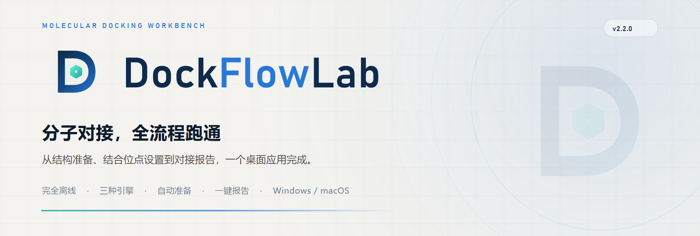
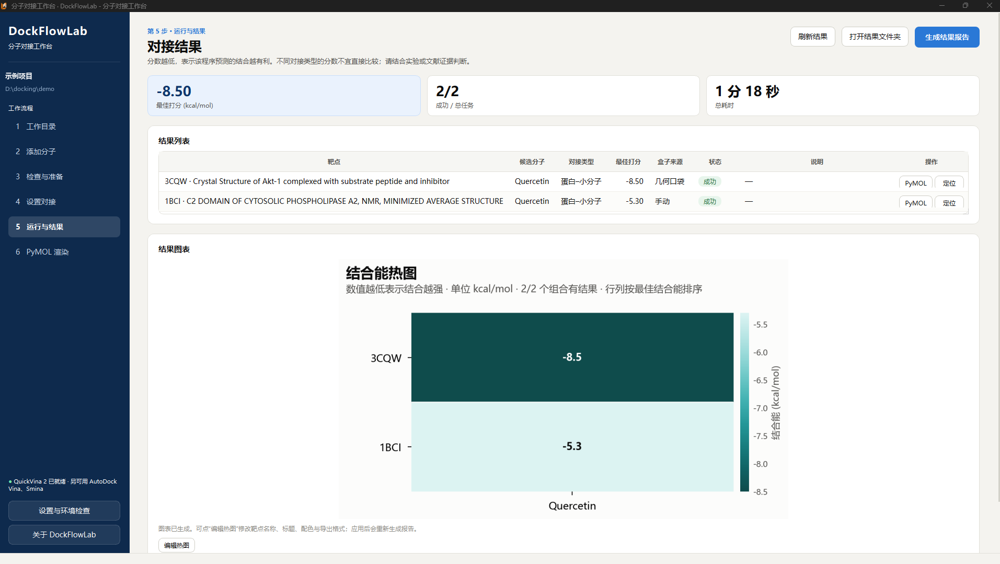
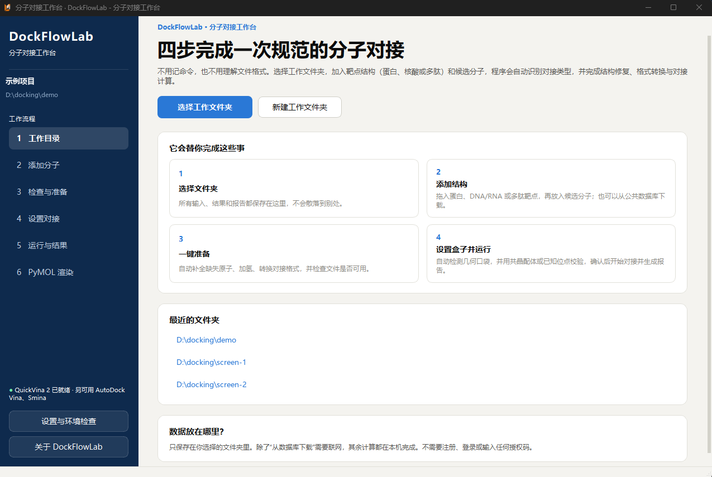
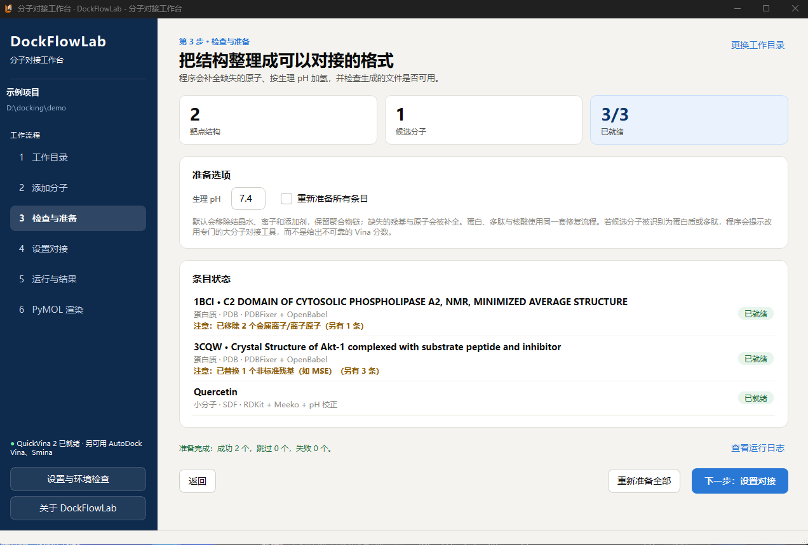
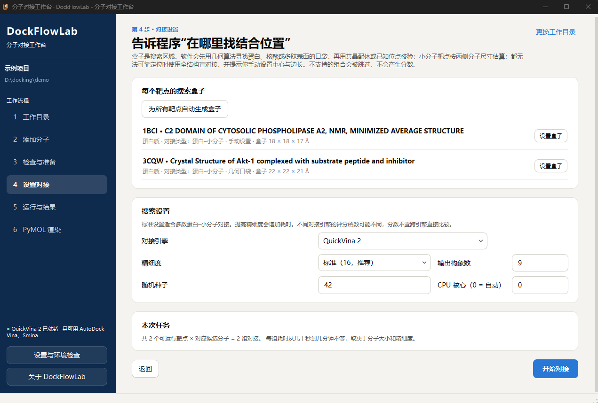
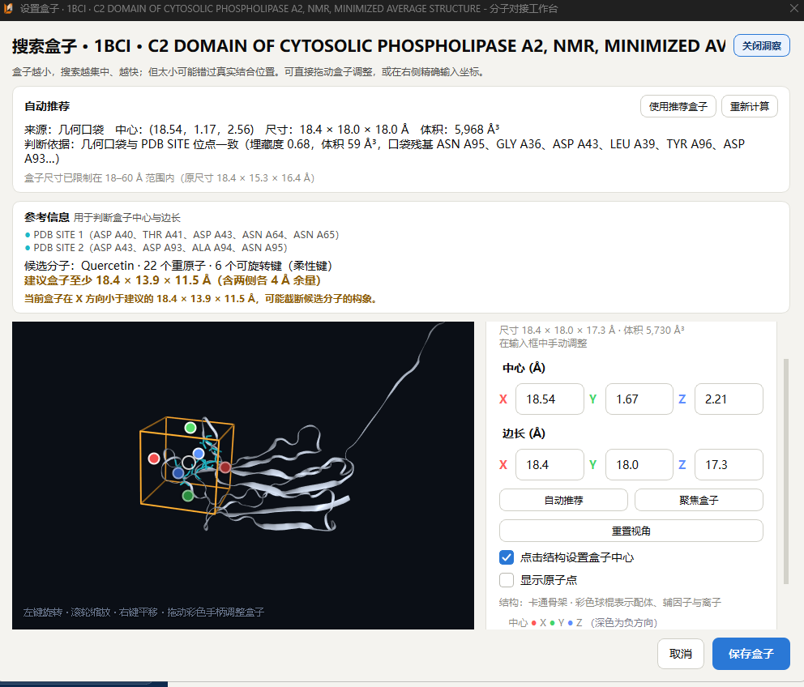
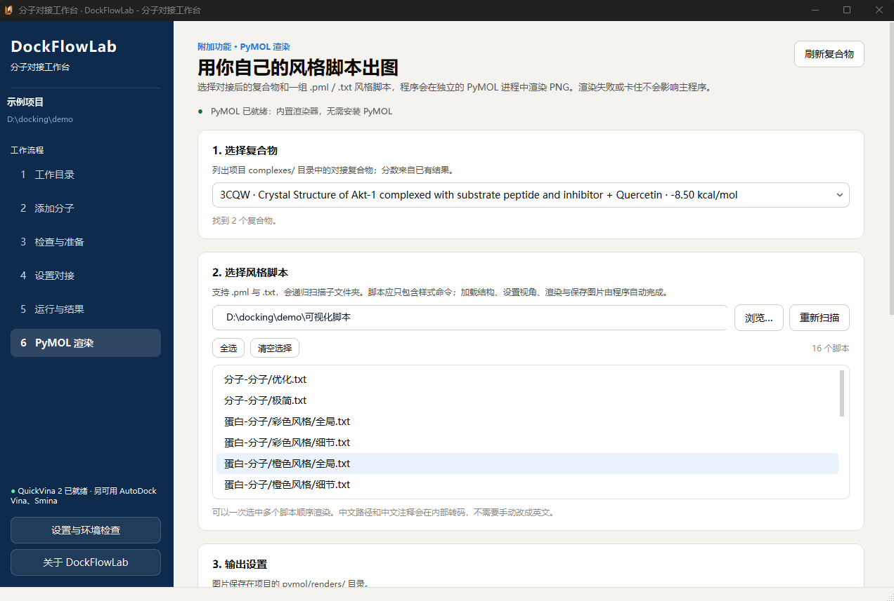
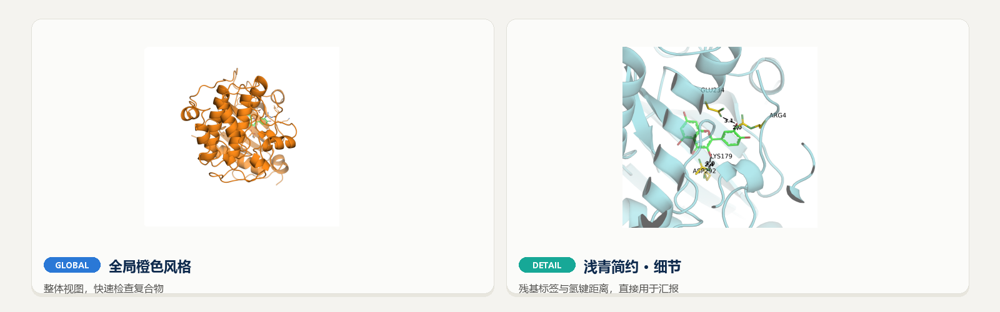
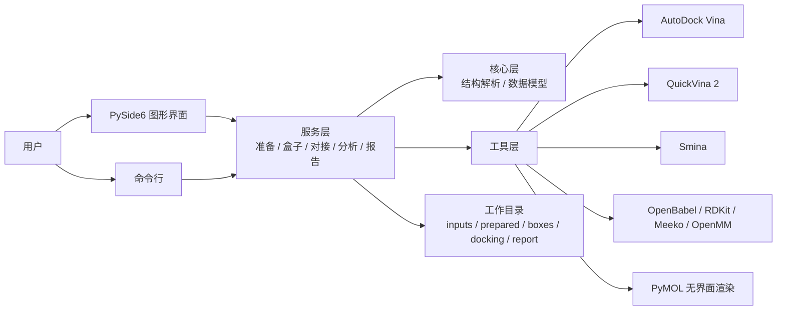

<p align="center">
  <picture>
    <source media="(prefers-color-scheme: dark)" srcset="docs/assets/banner-dark.png">
    
  </picture>
</p>

<p align="center">
  
  
  
  
  
  <a href="https://github.com/IBN-Spring/DockFlowLab/stargazers"></a>
</p>

<h3 align="center">把一次规范的分子对接，装进一个桌面窗口</h3>

<p align="center">
  靶点结构和候选分子拖进来，剩下的交给向导：结构修复、加氢、口袋定位、<br>
  对接计算、结合能热图与中文报告，全部在本地完成。
</p>

<p align="center">
  <a href="#快速开始"><b>下载使用</b></a> ·
  <a href="#五步跑完一次对接">五步流程</a> ·
  <a href="#功能">功能</a> ·
  <a href="#命令行">命令行</a> ·
  <a href="#常见问题">常见问题</a>
</p>

<p align="center">
  
</p>

<p align="center">
  <sub>示例项目：3CQW 与 1BCI 两个靶点 × Quercetin，QuickVina 2 完成 2/2 组对接，最佳 −8.50 kcal/mol。<br>
  对接分数用于同一项目内排序，不等同于实验测得的结合亲和力。</sub>
</p>

**DockFlowLab（分子对接工作台）** 是一个面向科研人员的跨平台桌面工具。它不要求你会写
Python，也不要求你先把 PDB 转成 PDBQT、再去找口袋、再单独装一个 Vina。只要选一个工作
目录，按向导走完，就能得到可排序、可追溯、可写进汇报的对接结果。

- **全流程跑通**：结构准备、口袋检测、盒子设置、对接、分析、报告、出图，一个程序完成。
- **完全离线**：安装后不需要联网、账号或授权码；只有主动下载公共结构时才访问网络。
- **多场景**：蛋白、多肽、核酸、小分子都可以作为靶点，候选分子限小分子，程序自动识别结构类型。
- **科学可信**：分数只来自真实对接引擎，记录引擎版本、盒子与随机种子；不支持的体系明确拒绝，不伪造分数。
- **操作简单**：五步向导 + 中文界面 + 合理默认值，第一次用也能跑完。
- **跨平台**：Windows 10/11 x64 与 macOS Apple Silicon，共用同一套服务层与命令行。

## 项目定位与边界

> **DockFlowLab 目前只支持“小分子配体”对接。**
>
> 靶点可以是蛋白质、多肽/短肽、DNA/RNA，也可以是另一个小分子；候选分子必须是
> **小分子**。蛋白–蛋白、蛋白–多肽、多肽–多肽、核酸–大分子等体系不在支持范围内，
> 请使用 HADDOCK、RosettaDock、ClusPro 等专门工具。程序会在导入阶段识别结构类型，
> 对不支持的组合明确拒绝并说明原因，不会生成看似合理但不可靠的分数。

DockFlowLab 的定位是**轻量、开源、离线、打开即用**的桌面工作台。“轻量”指流程和部署：
单机运行，不需要服务器、数据库、账号、授权码或联网激活；安装包内置对接引擎和 PyMOL，
体积较大，但解压后即可使用，不需要再配置 Python 环境。

- **完全免费**：MIT 许可，源码公开，个人、教学与商业使用均不收费。
- **数据留在本机**：结构、结果和日志只写入你选择的工作目录，不上传服务器。
- **欢迎一起改进**：遇到问题、想要新功能，欢迎提交
  [Issue](https://github.com/IBN-Spring/DockFlowLab/issues)；能复现的问题会优先处理。
- **尊重现有软件**：市面上已有成熟的商业分子对接套件，它们在大规模虚拟筛选、共价对接、
  自由能计算和技术支持等方面更完整。DockFlowLab 不试图替代或否定这些软件，也不以免费
  去挤压商业软件的空间；它只是为预算有限、需要离线、希望查看和修改源码的用户提供另一
  种选择。课题若需要商业套件的完整功能与支持，请继续使用它们。

---

## 目录

- [项目定位与边界](#项目定位与边界)
- [为什么是 DockFlowLab](#为什么是-dockflowlab)
- [五步跑完一次对接](#五步跑完一次对接)
- [功能](#功能)
- [核心实现](#核心实现)
- [支持的对接场景](#支持的对接场景)
- [快速开始](#快速开始)
- [命令行](#命令行)
- [从源码运行](#从源码运行)
- [架构](#架构)
- [项目结构](#项目结构)
- [科学边界](#科学边界)
- [常见问题](#常见问题)
- [参与贡献](#参与贡献)
- [许可与致谢](#许可与致谢)

## 为什么是 DockFlowLab

分子对接本身并不神秘，麻烦的是它周边的十几种格式、脚本和软件。DockFlowLab 把这些步骤
收进同一个项目目录，并把每一步“为什么这样判断”留在界面上。

<table>
  <tr>
    <td width="50%" valign="top">
      <b>全流程跑通，不装第二套软件</b><br><br>
      结构修复、按 pH 加氢、PDBQT 生成、几何口袋检测、对接、热图、HTML 报告都在一个窗口里。
      安装包内置三种对接引擎与无界面 PyMOL，不需要再配置 AutoDock Tools。
    </td>
    <td width="50%" valign="top">
      <b>完全离线，数据不出本机</b><br><br>
      没有账号、没有卡密、没有云端队列。项目文件只写在你选择的目录里；除主动从
      PDB / PubChem / AlphaFold / ChEMBL 下载结构外，其余计算全部在本机完成。
    </td>
  </tr>
  <tr>
    <td width="50%" valign="top">
      <b>自动识别，不为难非计算背景的用户</b><br><br>
      程序根据结构内容判断靶点与候选分子类型，自动选择准备流程；遇到不支持的组合会直接
      说明原因并给出替代工具，而不是给出一个看起来合理的假分数。
    </td>
    <td width="50%" valign="top">
      <b>自动化，但不黑箱</b><br><br>
      自动补全缺失原子、去除非标准残基、检测口袋、用共晶配体或 PDB SITE 交叉校验。
      每一步的判断依据、警告和跳过原因都会显示在准备页与报告里。
    </td>
  </tr>
  <tr>
    <td width="50%" valign="top">
      <b>科学可信，可复现</b><br><br>
      分数来自 AutoDock Vina / QuickVina 2 / Smina 的真实输出；报告记录引擎与版本、盒子中心与
      尺寸、exhaustiveness、随机种子和 CPU 数。同一套条件可以重复跑。
    </td>
    <td width="50%" valign="top">
      <b>三种引擎，卡死不硬扛</b><br><br>
      Vina 在个别复合物上可能长时间无输出。可以随时切换 QuickVina 2 或 Smina，也可以开启
      “失败自动回退”，让程序换一个已安装的引擎重试。
    </td>
  </tr>
  <tr>
    <td width="50%" valign="top">
      <b>结果直接能看、能汇报</b><br><br>
      结果表、结合能热图、柱状图、可离线打开的中文 HTML 报告；热图可改标题、靶点名称与
      配色，并导出 PNG / SVG / PDF。
    </td>
    <td width="50%" valign="top">
      <b>跨平台，也能批处理</b><br><br>
      Windows 与 macOS 使用同一套 Python 服务层；图形界面与命令行共享准备、对接、报告逻辑，
      便于在服务器上批量跑项目。
    </td>
  </tr>
</table>

## 五步跑完一次对接

1. **工作目录**：新建或选择一个文件夹。输入、准备产物、对接结果、报告都保存在这里。
2. **添加分子**：拖入靶点结构与候选分子，或从 PDB / PubChem / AlphaFold / ChEMBL 下载。
3. **检查与准备**：自动识别类型，补全缺失原子、按生理 pH 加氢、检查价态并生成对接格式。
4. **设置对接**：为每个靶点确认搜索盒子；程序自动检测口袋并交叉校验，也可以在 3D 视图中手动调整。
5. **运行与结果**：开始对接，查看结果表与图表，生成 HTML 报告或用 PyMOL 打开复合物。

> 第 6 步 **PyMOL 渲染** 是可选出图步骤，不参与对接计算。它可以批量套用你已有的
> `.pml` / `.txt` 风格脚本，把复合物导出成投稿级 PNG。

<table>
  <tr>
    <td width="50%" valign="top">
      
      <sub><b>1 · 工作目录</b><br>首页把流程归纳为四件事：选目录、加结构、一键准备、设置并运行。所有文件留在同一个项目目录。</sub>
    </td>
    <td width="50%" valign="top">
      
      <sub><b>2 · 检查与准备</b><br>自动补全缺失原子、加氢并生成 PDBQT；非标准残基、离子与配体处理都会逐条说明。</sub>
    </td>
  </tr>
  <tr>
    <td width="50%" valign="top">
      
      <sub><b>3 · 设置对接</b><br>每个靶点独立设置盒子；几何口袋与共晶配体 / PDB SITE 交叉验证，给出建议尺寸。</sub>
    </td>
    <td width="50%" valign="top">
      
      <sub><b>4 · 3D 盒子编辑器</b><br>拖动盒子手柄，或直接点击原子设置中心；实时显示尺寸、体积与判断依据。</sub>
    </td>
  </tr>
</table>

## 功能

### 结构准备：把“能用”变成“可对接”

- 读取 **PDB / mmCIF / PDBQT / MOL2 / SDF / MOL / SMILES / InChI** 等常见格式。
- 自动区分靶点与候选分子，并根据内容判断是小分子、多肽、蛋白还是核酸。
- 蛋白质与核酸使用 PDBFixer + OpenBabel 修复：补全缺失原子、按 pH 7.4 加氢、处理非标准残基。
- 小分子使用 RDKit + Meeko 生成 PDBQT，支持柔性配体；必要时调用 OpenBabel 转换格式。
- 问题条目会标红并说明原因，不会静默跳过；准备完成后给出成功 / 跳过 / 失败统计。

### 结合位点：先算口袋，再做交叉验证

- 从蛋白、核酸或多肽表面检测几何口袋，给出中心、尺寸与体积。
- 用共晶配体、PDB SITE 记录或已知位点校验口袋位置；两者一致时才推荐为“几何口袋”。
- 没有可靠依据时，程序会明确提示并建议手动设置盒子，而不是随便猜一个中心。
- 盒子尺寸会参考候选分子的长度与可旋转键数量，避免截断配体。
- 内置 NGL Viewer 渲染的卡通模型，支持拖动中心 / 面点、点击原子定位、精确输入坐标。

### 三种对接引擎，按任务切换

| 引擎 | 版本 | 适合场景 | 说明 |
| --- | --- | --- | --- |
| **AutoDock Vina** | 1.2.7 | 常规蛋白–小分子对接 | 默认引擎，文献使用最广 |
| **QuickVina 2** | 2.1 | Vina 较慢或卡死的复合物 | 基于 Vina 的加速实现，参数含义接近 |
| **Smina** | 2020.12.10 | 需要换评分函数或交叉检查 | 支持 Vinardo 等评分函数，结果用于相对排序 |

- 可在界面或命令行按项目切换引擎，不需要改配置。
- 开启“引擎回退”后，首选引擎卡死或失败会自动改用另一个已安装的引擎重试，并在结果中注明
  实际使用的引擎。
- **不同引擎、不同版本的分数不能直接比较。** 报告会记录实际引擎与版本，提醒同一批结果只在
  相同条件下排序。

### 结果、图表与报告

- 结果表包含靶点、候选分子、对接类型、最佳打分、盒子来源、状态与说明。
- 成功结果可点 **细节** 打开 3D 相互作用视图：蛋白背景半透明显示，配体与接触残基突出标记，
  并用虚线连接氢键、疏水作用与范德华接触；右侧同步列出残基、原子与距离。点击列表条目或
  3D 标签会加粗对应的金色虚线并定位该残基，也可分别隐藏三类接触、3D 标签或整个右侧列表。
- 相互作用按重原子距离与元素类型做几何判定，用于快速复核构象；没有计算氢键 D–H…A 角度，
  正式分析建议使用 PLIP 等专门工具。
- 结合能热图与柱状图使用统一的科学配色；支持修改标题、靶点显示名称、配色方案。
- 热图可导出 **PNG / SVG / PDF**：PNG 用于报告与预览，SVG 可继续编辑，PDF 适合打印。
- 一键生成**可离线打开的中文 HTML 报告**，包含参数、结果、图表与评分含义说明。
- 结果目录同时保留引擎原始输出，方便复核或换工具复算。

### PyMOL 渲染：用你自己的风格脚本出图

<p align="center">
  
</p>

- 选择对接后的复合物，再选择一个或多个 `.pml` / `.txt` 风格脚本；也可以选中整个脚本文件夹。
- 脚本只需包含样式命令（配色、表示方式、视角等），加载结构、设置视角、保存图片由程序完成。
- 每个任务在独立的 PyMOL 进程中渲染，渲染失败或卡住不会影响主程序。
- Windows 与 macOS 安装包均内置无界面 PyMOL 3.1，**无需用户另装 PyMOL**；也可以在设置中
  指定本机 PyMOL，源码运行时同样适用。
- 标签字号会按输出分辨率自动补偿，残基编号与氢键距离在高分辨率下仍然清晰。

<p align="center">
  
</p>

<p align="center">
  <sub>左：全局橙色风格，快速检查复合物整体构象。右：浅青细节风格，标出残基标签与氢键距离，可直接用于汇报。</sub>
</p>

## 核心实现

这一节把受体/配体预处理、口袋预测和盒子生成写清楚。目的不是宣称发明了对接算法，
而是让实现**可核查**：哪些思想来自公开文献或开源组件，哪些是本项目自己的工程实现。
相关代码集中在 `src/dockflowlab/services/`，可以直接对照阅读。

### 1. 受体预处理：先让结构“可对接”

入口：[services/receptor.py](src/dockflowlab/services/receptor.py)。图形界面的“开始准备”
与命令行的 `prepare` 走同一条服务层路径，不会出现两套结果。

1. **识别结构类型。** 按文件内容而不是扩展名判断蛋白质、多肽、核酸或小分子；小分子不能
   放在靶点栏，会提示改用“候选分子”。PDBQT 直接校验并复用；PDB 有多个 `MODEL` 时只取
   第一个；mmCIF 先经 OpenBabel 转成 PDB，再进入统一流程。
2. **按链选择并排除共晶配体链。** 链选择按索引而不是链 ID，避免重复链 ID 或空链 ID 误删。
   多肽类共晶配体有时被拆成标准氨基酸（`ATOM`）记录，`removeHeterogens` 删不掉，程序会
   先用 `find_ligand_chains` 找到整条配体链并移除，防止它占据结合位点。
3. **PDBFixer 修复。** 替换 MSE 等非标准残基；默认调用
   `removeHeterogens(keepWater=False)` 移除水、金属离子、共晶配体和辅因子；补全缺失残基
   与缺失原子（固定随机种子 42，保证可复现）；最后按 pH 7.4 加氢。补全残基超过 30 个时
   会提示模型可靠性下降。
4. **保留辅因子模式。** 高级用户可以保留非水、非离子的小分子辅因子；程序会明确警告
   “请确认它们确实应作为受体的一部分”，不会默认替用户做这个判断。
5. **转成刚性 PDBQT。** 修复后的 PDB 交给 OpenBabel，以 Gasteiger 电荷、`rigid=True`
   写出受体 PDBQT，再用内置校验器检查原子数与格式。受体默认保持实验构象，不做全局能量
   最小化，减少对实验结构的扰动。
6. **失败不静默。** PDBFixer/OpenMM 不可用或修复失败时，退化为 OpenBabel 加氢与格式转换，
   并在结果里明确写出“结构未经过完整修复，缺失残基/原子不会被补全”。如果两种路径都不可
   用，任务直接失败，不会拿一个未经处理的结构继续对接。

> 输出：`prepared/targets/<名称>/` 下的修复版 PDB 与 PDBQT，旁边保留每一步的警告与统计。

### 2. 配体预处理：从任意格式到可旋转 PDBQT

入口：[services/ligand.py](src/dockflowlab/services/ligand.py)。

1. **类型闸门。** 候选分子栏只接受小分子。若文件实际是蛋白质、多肽或核酸，程序会拒绝，
   并提示把大分子放到“靶点结构”或不支持该体系，避免把蛋白误当成配体。
2. **读取。** SDF/MOL/MOL2 由 RDKit 读取；SDF 多记录时取第一条并警告；价态异常的记录用
   宽松模式读取；RDKit 失败时先经 OpenBabel 转成 SDF 再读。已有 PDBQT 只做校验和复用。
3. **去盐与去溶剂。** 用 RDKit 拆分子片段，保留重原子最多的有机片段，移除盐、溶剂等
   小碎片，并报告移除了多少重原子。
4. **补氢与三维构象。** 先 `Chem.AddHs`；输入只有二维坐标时用 **ETKDGv3** 生成三维构象
   （随机种子 42，失败时改用随机初始坐标重试）。如果分子已有三维坐标，则保留原构象。
5. **能量最小化。** 优先 MMFF94s；参数不全时退到 UFF；最多 500 步。没有可用力场时保留
   输入构象并明确警告，不假装“优化过”。
6. **生理 pH 质子化校正（可选）。** 通过 OpenBabel 的 pH 模型在 7.4 下重新分配质子化
   状态。只有重原子数不变时才接受校正结果，否则保留输入结构并警告。
7. **生成柔性 PDBQT。** 用 Meeko 的 `MoleculePreparation` + `PDBQTWriterLegacy` 写出
   含 `ROOT/BRANCH/TORSDOF` 的可旋转配体；校验通过才落盘。Meeko 失败时回退到 OpenBabel，
   并在结果中注明回退路径。
8. **刚性靶点模式。** 小分子–小分子对接时，先按上述流程准备，再移除扭转树，把该分子
   转成刚性受体，保证搜索空间只落在另一个分子上。

> 重原子超过 200 个或可旋转键超过 20 个时，程序会提示搜索空间和耗时显著增加；这类结果
> 应视为初步筛选，而不是高置信度结合模式。

### 3. 口袋预测：不依赖外部二进制的 LIGSITE 式实现

入口：[services/pockets.py](src/dockflowlab/services/pockets.py)。实现只依赖 NumPy/SciPy，
不需要另外安装 fpocket、P2Rank 等可执行文件，因此可以随应用跨平台打包，也方便逐行审查。

算法使用 **LIGSITE 的 P-S-P（protein–solvent–protein）思想**，具体步骤是：

1. **建网格。** 只取聚合物残基的重原子，按范德华半径把蛋白质占据的区域标记到网格上。
   默认间距 1.0 Å；结构很大时自动放宽到不低于 0.75 Å，并把网格单元总数限制在约 300 万，
   防止内存失控。
2. **找可及空腔。** 用 1.4 Å 探针（约等于水分子半径）计算每个空网格点到最近原子范德华
   表面的净空；再做三维连通，只保留与网格边界相连的溶剂区域，排除完全封闭的内部空腔。
3. **七方向包埋扫描。** 沿 x、y、z 和 4 条体对角线，在 9 Å 范围内检查每个空腔点两侧是否
   都能看到蛋白质，统计“P-S-P”成立的方向数。方向数越多，说明这个点被蛋白包围得越严实。
4. **形成候选口袋。** 保留同时满足以下条件的点：至少 4 个方向包埋、探针可及、与外部溶剂
   连通、距离蛋白质表面不超过 5 Å。然后做 3×3×3 连通聚类。
5. **过滤与打分。** 每个簇至少 20 个网格点、最大跨度不超过 35 Å、占据包围盒的比例不低于
   0.02。综合分数为：

   ```text
   score = 0.45 × 包埋度
         + 0.20 × 体积分数
         + 0.15 × 紧密度
         + 0.10 × 深度
         + 0.10 × 疏水性
   ```

   - 包埋度：平均 P-S-P 方向数 / 7；
   - 体积分数：`log1p(points / 50) / log1p(10)`，限制在 0–1；
   - 紧密度：网格点占包围盒比例 / 0.15，限制在 0–1；
   - 深度：平均表面距离 / 2.5 Å，限制在 0–1；
   - 疏水性：口袋点最近原子中 C/S 原子的比例。

6. **排序与缓存。** 按分数降序返回前 8 个口袋，同时给出中心、尺寸、体积、包埋度、深度、
   疏水性和附近残基。结果按“文件路径 + 修改时间 + 大小 + 链”缓存，界面切换页面时不会
   重复扫描。

这套实现是**几何启发式**：它回答“哪里像一个能被小分子进入的凹槽”，不预测结合亲和力，
也不保证一定具有生物学功能。有共晶配体或 PDB SITE 记录时，实验证据始终优先于几何预测。

### 4. 盒子生成：证据优先，几何兜底

入口：[services/boxes.py](src/dockflowlab/services/boxes.py)。自动盒子按固定顺序决策，
每一步都会把来源写进 `Box.source` 和 `Box.note`，报告里可以追溯：

| 顺序 | 依据 | 行为 |
| --- | --- | --- |
| 1 | 用户手动设置 | 采用用户中心/尺寸，并确保不小于“配体尺寸 + 安全边距” |
| 2 | 用户提供的参考分子 | 以参考分子坐标为位点，向外扩 `box_padding` |
| 3 | 几何口袋 + 共晶配体一致 | 采用联合盒子：口袋裁剪到配体附近 ±4 Å，再留 4 Å 边距 |
| 4 | 共晶配体（无一致口袋） | 以共晶配体为中心，尺寸加两侧 padding |
| 5 | 几何口袋 + PDB SITE 一致 | 采用联合盒子，规则同上 |
| 6 | PDB SITE 记录（无一致口袋） | 以 SITE 残基坐标为中心，外扩 6 Å |
| 7 | 无可靠证据 | 全结构盲对接，并明确警告结果仅供初步筛选 |

几个关键细节：

- **一致性不是看距离，而是看覆盖。** 对每个实验位点，计算其重原子到最近口袋采样点的
  距离；距离 ≤ 5 Å 视为被口袋覆盖。共晶配体要求覆盖率 ≥ 0.35，PDB SITE 要求 ≥ 0.50。
  共晶配体阈值更低，是因为配体可能伸出口袋；SITE 记录本身就是口袋衬里残基，所以要求更严。
- **联合盒子会裁掉远端。** 细长的溶剂通道会让口袋包围盒异常膨胀；与实验位点联合时，只保留
  实验位点 ±4 Å 范围内的口袋部分，再加 4 Å 边距，既保留口袋形状又控制搜索空间。
- **盒子必须装得下配体。** 程序读取每个候选分子的三维跨度，按“逐轴最大跨度 + 两侧各 4 Å”
  计算最低尺寸；手动盒子、参考分子盒子、口袋盒子、共晶盒子和盲对接盒子都会与这个最低
  尺寸取逐轴最大值。
- **尺寸有边界。** 默认限制在 18–60 Å（可在设置中调整）；手动输入允许 5–150 Å，但超出
  默认范围会给出提示。体积超过 40,000 ų 提示耗时增加，低于 1,500 ų 提示可能限制构象。
- **小分子靶点单独处理。** 分子–分子对接时，盒子以靶点分子为中心，覆盖两个分子的总跨度，
  并提示用户检查结果。

### 5. 为什么这样设计

- **先把证据用尽，再猜。** 共晶配体和 PDB SITE 是实验信息；几何口袋只是补充。两者一致时
  联合使用，不一致时明确回退并说明原因，避免“检测到一个口袋就当成结合位点”。
- **所有降级都可见。** PDBFixer 失败、Meeko 失败、几何口袋不可用、盲对接等情况都会写入
  警告和报告，不会静默换一条路径。
- **可复现优先。** 固定的默认随机种子、明确记录引擎版本/盒子来源/尺寸，以及保留引擎原始
  输出，都是为了同一项目能复核。
- **不把几何预测包装成实验结论。** 口袋分数、盒子来源和对接分数是三类不同信息，报告里
  分开呈现。

### 6. 算法来源与原创性说明

DockFlowLab 的 Python 代码为独立实现，未直接复制 fpocket、P2Rank、AutoDockTools 等项目的
源码。但**算法思想不是凭空产生的**，主要来自公开文献和开源组件：

| 环节 | 采用的思想 / 组件 | 来源 | 本项目的工作 |
| --- | --- | --- | --- |
| 口袋检测 | LIGSITE 的 P-S-P 扫描与溶剂连通性 | Hendlich et al., 1997 | NumPy/SciPy 网格实现、评分权重、缓存、与实验位点的一致性校验 |
| 分子对接 | AutoDock Vina / QuickVina 2 / Smina | Trott & Olson, 2010；Eberhardt et al., 2021；Alhossary et al., 2015；Koes et al., 2013 | 引擎适配、卡死/失败回退、结果归一化与报告 |
| 配体读取与构象 | [RDKit](https://www.rdkit.org/)；ETKDGv3；MMFF94s / UFF | Riniker & Landrum, 2015；Halgren, 1999 | 读取、去盐、三维构象、能量最小化、pH 校正与回退 |
| 结构修复 | [PDBFixer](https://github.com/openmm/pdbfixer) / OpenMM | Eastman et al., 2017 | 链与共晶配体处理、警告、OpenBabel 回退 |
| 格式转换 | OpenBabel | O'Boyle et al., 2011 | 统一适配器、PDBQT 校验 |
| 配体 PDBQT | [Meeko](https://github.com/forlilab/Meeko)（Forli lab） | Meeko 文档与源码 | 集成、校验、OpenBabel 回退 |
| 3D 视图 / 出图 | NGL Viewer；[PyMOL](https://pymol.org/)（Schrödinger） | Rose et al., 2018 | 嵌入、无界面渲染、风格脚本 |
| 盒子决策 | 证据优先的决策树 + 覆盖率共识 | 本项目 | 决策顺序、联合盒子裁剪、配体尺寸约束、边界与警告 |

**本项目的原创部分**主要是工程与决策层：跨平台预处理流水线及其回退、口袋检测的具体实现与
评分、口袋/共晶配体/SITE 的一致性校验、盒子决策树与尺寸约束、以及把这些步骤组织成可追溯
的桌面工作流。底层物理模型、评分函数和文件格式并不是本项目发明的。

如果你认为某段实现与现有项目过于相似、或某篇文献应被补充引用，欢迎提交 Issue 指出；
我们会核对代码来源并更新署名。MIT 许可只覆盖本项目的原创代码，内置第三方组件仍遵循各自
的许可证，详见[许可与致谢](#许可与致谢)。

### 主要参考文献

1. Hendlich M, Rippmann F, Barnickel G. LIGSITE: automatic and efficient detection of potential small molecule-binding sites in proteins. *J Mol Graph Model*. 1997;15(6):359–363. doi:10.1016/S1093-3263(98)00002-3
2. Trott O, Olson AJ. AutoDock Vina: improving the speed and accuracy of docking with a new scoring function, efficient optimization, and multithreading. *J Comput Chem*. 2010;31(2):455–461. doi:10.1002/jcc.21334
3. Eberhardt J, Santos-Martins D, Tillack AF, Forli S. AutoDock Vina 1.2.0: new docking methods, expanded force field, and Python bindings. *J Chem Inf Model*. 2021;61(8):3891–3898. doi:10.1021/acs.jcim.1c00203
4. Alhossary A, Handoko SD, Mu Y, Kwoh CK. Fast, accurate, and reliable molecular docking with QuickVina 2. *Bioinformatics*. 2015;31(13):2214–2216. doi:10.1093/bioinformatics/btv082
5. Koes DR, Baumgartner MP, Camacho CJ. Lessons learned in empirical scoring with smina from the CSAR 2011 benchmarking exercise. *J Comput Aided Mol Des*. 2013;27(3):221–234. doi:10.1007/s10822-013-9644-8
6. Riniker S, Landrum GA. Better informed distance geometry: using what we know to improve conformation generation. *J Chem Inf Model*. 2015;55(12):2562–2574. doi:10.1021/acs.jcim.5b00654
7. O'Boyle NM, Banck M, James CA, Morley C, Vandermeersch T, Hutchison GR. Open Babel: an open chemical toolbox. *J Cheminform*. 2011;3:33. doi:10.1186/1758-2946-3-33
8. Eastman P, Swails J, Chodera JD, et al. OpenMM 7: rapid development of high performance algorithms for molecular dynamics. *PLoS Comput Biol*. 2017;13(7):e1005659. doi:10.1371/journal.pcbi.1005659
9. Halgren TA. MMFF VI. MMFF94s option for energy minimization studies. *J Comput Chem*. 1999;20(7):720–729. doi:10.1002/(SICI)1096-987X(199905)20:7<720::AID-JCC7>3.0.CO;2-X
10. Rose AS, Hildebrand PW. NGL Viewer: web-based molecular graphics for large complexes. *Bioinformatics*. 2018;34(21):3755–3758. doi:10.1093/bioinformatics/bty419

## 支持的对接场景

**候选分子只接受小分子。** 程序不需要你预先选择模式：它根据结构内容自动判断靶点类型，
并在结果中标注对接类型。不支持的组合会直接说明原因，不会继续计算。

| 靶点结构 | 候选分子 | 状态 | 说明 |
| --- | --- | --- | --- |
| 蛋白质 | 小分子 | ✅ 支持 | 主流程，最可靠 |
| 多肽 / 短肽 | 小分子 | ✅ 支持 | 靶点柔性较高，结果需谨慎解读 |
| DNA / RNA | 小分子 | ✅ 支持 | 建议结合共晶配体或已知位点设置盒子 |
| 小分子 | 小分子 | ✅ 支持 | 靶点按刚性受体处理，适合快速筛选 |
| 蛋白质 | 多肽 | ❌ 不支持 | 多肽自由度超出 Vina 可靠搜索范围，请用 HADDOCK / RosettaDock |
| 蛋白质 | 蛋白质 | ❌ 不支持 | 请用 ClusPro / HADDOCK / RosettaDock |
| 核酸 | 蛋白质 / 多肽 / 核酸 | ❌ 不支持 | 需要专门的核酸–大分子对接工具 |
| 小分子 | 蛋白质 / 多肽 / 核酸 | ❌ 不支持 | 请把大分子放在“靶点结构”一栏 |
| 多肽 | 多肽 | ❌ 不支持 | 请用 HADDOCK / RosettaDock |

## 快速开始

### 下载

| 平台 | 推荐文件 | 说明 |
| --- | --- | --- |
| Windows 10/11 x64 | `DockFlowLab-Windows-x64.zip` | 解压即用，内置三种对接引擎与无界面 PyMOL |
| macOS 11+ Apple Silicon | `DockFlowLab-macOS-arm64.dmg` | 拖入“应用程序”即可；内置三种引擎与 PyMOL |

- [GitHub Releases](https://github.com/IBN-Spring/DockFlowLab/releases/latest)（推荐，单文件直接下载）
- [Gitee 发行版](https://gitee.com/spiral_IBN/dock-flow-lab/releases)（国内网络）
  - Gitee 单个附件限 100MB，安装包已按 90MB 分卷，并附 `合并并解压-Windows.bat` /
    `合并并打开-macOS.command` 与 SHA256 校验文件。请下载同一版本的全部分卷后再合并。

### Windows

1. 下载 `DockFlowLab-Windows-x64.zip` 并解压到任意目录。
2. 双击 `DockFlowLab.exe`。不需要安装，不写注册表。
3. 首次启动若被 SmartScreen 拦截，点击“更多信息 → 仍要运行”。

### macOS

1. 下载 `DockFlowLab-macOS-arm64.dmg`，打开后把 `DockFlowLab.app` 拖入“应用程序”。
2. 首次打开若提示“无法验证开发者”，右键应用 →“打开”，或在“系统设置 → 隐私与安全性”中允许。
3. 安装包已内置三种引擎与 PyMOL。若要改用本机安装的其他版本，可通过
   `brew install autodock-vina` 或 `conda install -c conda-forge vina qvina smina` 安装，
   并在“设置”中指定路径。源码运行时同理。

### 数据放在哪里

| 内容 | Windows | macOS |
| --- | --- | --- |
| 用户设置 | `%APPDATA%\DockFlowLab` | `~/Library/Application Support/DockFlowLab` |
| 日志与缓存 | `%LOCALAPPDATA%\DockFlowLab` | `~/Library/Caches/DockFlowLab` |
| 对接项目 | 你选择的任意文件夹 | 你选择的任意文件夹 |

卸载时删除程序文件夹即可；如需彻底清理，再删除上表中的设置与缓存目录。项目目录中的
`inputs/`、`prepared/`、`docking/`、`report/` 等不会被程序删除。

### 完全离线

安装完成后，结构准备、对接、分析、报告和 PyMOL 渲染都不需要网络。只有你主动点击
“从数据库下载”时，程序才会访问 PDB、PubChem、AlphaFold 或 ChEMBL。没有登录、账号、
授权码或使用次数限制。

## 命令行

图形界面与命令行共用同一套服务层，适合批处理和服务器环境：

```bash
# 检查引擎、OpenBabel、RDKit、Meeko、OpenMM 等组件
dockflowlab-cli doctor

# 新建项目
dockflowlab-cli init D:/docking/demo --name 阿司匹林筛选

# 导入结构
dockflowlab-cli import D:/docking/demo protein.pdb --kind target --name 1BCI
dockflowlab-cli import D:/docking/demo aspirin.sdf --kind ligand --name 阿司匹林

# 准备、对接、报告
dockflowlab-cli prepare D:/docking/demo
dockflowlab-cli dock D:/docking/demo --exhaustiveness 8
dockflowlab-cli dock D:/docking/demo --engine qvina2
dockflowlab-cli report D:/docking/demo
```

也可以直接从公共数据库下载：

```bash
dockflowlab-cli fetch D:/docking/demo pdb 1BCI
dockflowlab-cli fetch D:/docking/demo pubchem "aspirin" --kind ligand
```

## 从源码运行

需要 Python 3.10–3.12。推荐使用 conda 环境（Windows 上 OpenMM 用 conda 安装最省事）：

```bash
conda create -n DockFlowLab python=3.12 -y
conda activate DockFlowLab
conda install -c conda-forge rdkit openbabel openmm pdbfixer -y
pip install -e ".[dev]" meeko
python -m dockflowlab
```

只使用 pip 时：

```bash
python -m pip install -e ".[chem,dev]"
python -m dockflowlab
```

Windows 上若 `openmm` 没有可用的 wheel，请改用上面的 conda 命令。

运行测试：

```bash
PYTHONPATH=src python -m pytest
```

打包分发：

```bat
packaging\build_windows.bat
```

```bash
bash packaging/build_macos.sh
```

产物位于 `release/`，目录版保留在 `dist/`。依赖布局、图标、引擎收集、macOS 签名与公证等
细节见 [docs/packaging.md](docs/packaging.md)。

## 架构



图形界面只负责交互与展示，所有计算都落在服务层。这样同一套准备、对接与报告逻辑可以
直接从命令行调用，也方便在不启动 GUI 的服务器上复现结果。

## 项目结构

```text
src/dockflowlab/
  app.py            图形界面入口
  cli.py            命令行入口
  workspace.py      工作目录与项目文件
  config.py         用户设置与平台目录
  core/             结构解析、数据模型等纯计算基础
  services/         准备、盒子、对接、分析、报告、下载
  tools/            对接引擎 / OpenBabel / 运行时适配
  ui/               PySide6 五步向导界面
  resources/        图标、报告模板、内置对接引擎
packaging/          PyInstaller 配置与构建脚本
tests/              单元测试与端到端集成测试
docs/               用户、架构与打包文档
```

更多设计说明见 [docs/architecture.md](docs/architecture.md)，界面操作细节见
[docs/user-guide.md](docs/user-guide.md)。

## 科学边界

DockFlowLab 的目标是让流程**规范、可复现、可解释**，而不是把对接包装成实验结论。

- **分数是经验评分函数的输出**，单位为 kcal/mol，数值越低表示该程序预测的结合越有利。
  它不等同于实验测得的 ΔG 或 Kd，也不能单独证明结合模式。
- **只在相同条件下排序**。分数会随引擎与版本、评分函数、受体 / 配体预处理、是否保留水与
  离子、盒子范围、exhaustiveness 和随机种子变化。不同软件或不同引擎的分数不宜直接比较。
- **受体通常按刚性处理**。Vina 系列不模拟受体的大尺度构象变化；多肽、核酸等柔性靶点的
  结果更适合相对排序，需要谨慎解读。
- **默认去水、去离子、去添加剂**，按 pH 7.4 加氢。若某个水分子或金属离子对结合至关重要，
  当前流程不会自动保留，需要在项目外单独评估。
- **小分子片段**通常只能得到较小的负值，不应据此判断“不结合”。
- 关键结论请结合实验、文献或更高精度的自由能方法验证。

这些限制不是免责声明，而是写进报告里的判断依据。程序宁可明确说“不支持”，也不会用占位
分数填满表格。

## 常见问题

<details>
<summary><b>它和 AutoDock Tools / PyRx 有什么区别？</b></summary>

DockFlowLab 把结构准备、口袋检测、盒子设置、三种引擎、结果分析、HTML 报告和 PyMOL 出图
放在同一条向导里，并自动整理项目目录。它不要求你手工把 PDB 转成 PDBQT，也不要求你另外
安装 PyMOL。底层仍然是标准的 AutoDock Vina 系列引擎，输出可以继续用其他工具复核。

</details>

<details>
<summary><b>我的分数能和论文里的 Vina 分数直接比吗？</b></summary>

不建议。即使是同一个引擎，受体准备、质子化状态、盒子大小、exhaustiveness 和版本不同，
分数都会变化。请在同一项目、同一套参数下比较候选分子；跨研究比较只能作为非常粗略的参考。

</details>

<details>
<summary><b>需要自己安装 Vina 或 PyMOL 吗？</b></summary>

Windows 与 macOS 安装包均内置 AutoDock Vina 1.2.7、QuickVina 2.1、Smina 2020.12.10 和
无界面 PyMOL 3.1，开箱即用。若想改用本机安装的其他版本，可在“设置”中指定路径。从源码
运行时，程序会查找系统中的引擎。

</details>

<details>
<summary><b>支持蛋白–蛋白或蛋白–多肽对接吗？</b></summary>

不支持。这类体系的自由度远超 Vina 评分函数的适用范围，硬跑出来的分数没有解释力。
程序会提示改用 HADDOCK、RosettaDock 或 ClusPro。

</details>

<details>
<summary><b>会把我的结构上传到服务器吗？</b></summary>

不会。所有准备与对接都在本机完成。只有你主动使用“从数据库下载”功能时，程序才会向对应
公共数据库发起请求。项目目录、日志和报告都留在本地。

</details>

<details>
<summary><b>macOS 提示“无法验证开发者”怎么办？</b></summary>

右键 `DockFlowLab.app` →“打开”，或在“系统设置 → 隐私与安全性”中允许。当前构建未做
Apple 公证，首次打开需要这一步。若仍被拦截，可在终端执行
`xattr -dr com.apple.quarantine /Applications/DockFlowLab.app` 后重试。

</details>

<details>
<summary><b>可以用于商业项目吗？</b></summary>

本项目使用 MIT License，可以商用。内置的 Vina / QuickVina 2 / Smina 以 Apache License 2.0
发布，PyMOL 是 Schrödinger, LLC 的商标，分发时请保留相应许可与声明。

</details>

## 路线图

以下是方向，不是承诺；优先级会根据实际使用反馈调整。

- Windows / macOS 安装包的代码签名与 Apple 公证
- 更多报告模板与示例项目
- 批量项目队列与更完整的命令行参数
- 英文界面与文档

## 参与贡献

欢迎提交 Issue 和 Pull Request。请先阅读 [CONTRIBUTING.md](CONTRIBUTING.md)，其中包含
问题复现所需的信息、日志位置、测试命令和代码约定。请不要上传未公开的受体结构、患者数据
或实验室内部资料。

也可以加入**生信交流群（QQ 群）：306484855**，交流结构准备、对接参数与结果解读。提问时
请尽量附上软件版本、报错信息和复现步骤；同样请不要上传未公开的结构或隐私数据。

## 许可与致谢

本项目使用 [MIT License](LICENSE)。

- 内置 **AutoDock Vina 1.2.7**、**QuickVina 2.1**、**Smina 2020.12.10** 均由
  The Scripps Research Institute 以 Apache License 2.0 发布，许可文件见
  [vina](src/dockflowlab/resources/vina/LICENSE)、
  [qvina2](src/dockflowlab/resources/qvina2/LICENSE)、
  [smina](src/dockflowlab/resources/smina/LICENSE)。
- 3D 盒子视图使用 **NGL Viewer 2.5.0**（MIT），许可见
  [ngl](src/dockflowlab/resources/ngl/LICENSE)。
- 感谢 AutoDock Vina、QuickVina 2、Smina、NGL Viewer、Meeko、RDKit、OpenBabel、OpenMM、
  PDBFixer、PySide6 / QtWebEngine、matplotlib 与 pandas 的开发者与维护者。

> Includes PyMOL(TM). PyMOL is a trademark of Schrodinger, LLC.

## 引用

如果 DockFlowLab 对你的研究或教学有帮助，请引用本项目。机器可读的引用信息见
[CITATION.cff](CITATION.cff)。

```bibtex
@software{dockflowlab2026,
  title        = {DockFlowLab: 面向非专业用户的跨平台分子对接桌面工作台},
  author       = {{IBN-Spring}},
  year         = {2026},
  version      = {2.2.0},
  url          = {https://github.com/IBN-Spring/DockFlowLab},
  license      = {MIT}
}
```

---

<p align="center">
  <b>如果 DockFlowLab 帮你省下了一个下午的格式转换，欢迎点一个 Star ⭐</b><br><br>
  <a href="https://github.com/IBN-Spring/DockFlowLab">GitHub</a> ·
  <a href="https://gitee.com/spiral_IBN/dock-flow-lab">Gitee</a> ·
  <a href="https://github.com/IBN-Spring/DockFlowLab/issues">问题反馈</a> ·
  生信交流群（QQ）306484855
</p>
